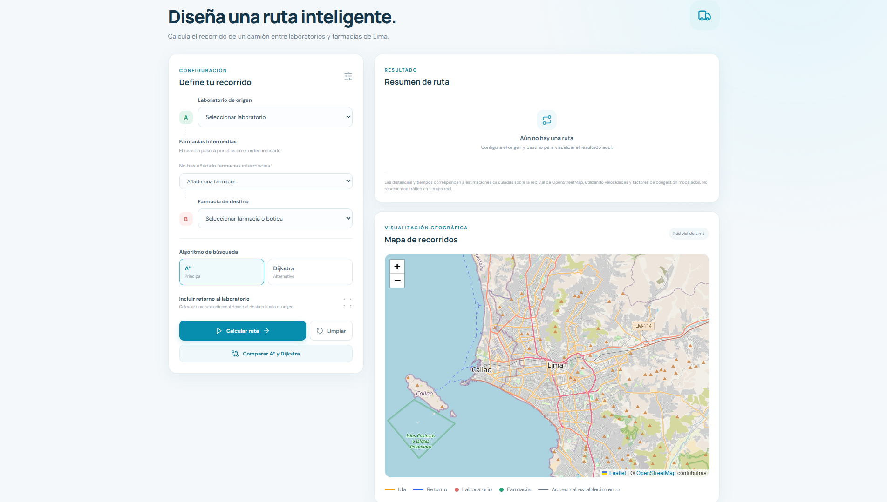

# Intelligent Traffic Application



Aplicación web académica para la planificación y el cálculo de rutas de distribución de productos médicos entre laboratorios farmacéuticos y farmacias o boticas de Lima Metropolitana.

El proyecto utiliza algoritmos de búsqueda en grafos para calcular recorridos considerando los tiempos estimados de desplazamiento entre establecimientos. Además, permite comparar los resultados obtenidos mediante los algoritmos A* y Dijkstra.

## Descripción del proyecto

La aplicación busca apoyar la planificación de recorridos de vehículos encargados de distribuir productos médicos desde un laboratorio farmacéutico hacia diferentes farmacias y boticas.

Para representar el problema se utiliza un grafo dirigido cuyos nodos corresponden a establecimientos farmacéuticos y cuyas aristas representan conexiones entre ellos. Cada conexión contiene información sobre la distancia estimada y el tiempo estimado de desplazamiento.

El usuario puede seleccionar un laboratorio de origen, una farmacia de destino y, opcionalmente, establecimientos intermedios por los que debe pasar el recorrido.

El sistema calcula la ruta solicitada mediante el algoritmo seleccionado y permite comparar los resultados de A* y Dijkstra para una misma configuración.

## Funcionalidades

- Consulta y carga de establecimientos farmacéuticos disponibles.

- Selección de un laboratorio como punto de origen.

- Selección de una farmacia o botica como destino.

- Incorporación, eliminación y reordenamiento de farmacias intermedias.

- Cálculo de rutas mediante el algoritmo A*.

- Cálculo de rutas mediante el algoritmo de Dijkstra.

- Comparación de los resultados de ambos algoritmos.

- Obtención de métricas del recorrido, como distancia estimada, tiempo estimado y cantidad de nodos explorados.

- Opción para calcular un recorrido de retorno desde la farmacia de destino hasta el laboratorio de origen.

- Comunicación entre el frontend y el backend mediante una API REST.

## Tecnologías utilizadas

### Backend

- **Python**: lenguaje de programación.

- **Flask**: desarrollo de la API y gestión de solicitudes HTTP.

- **Flask-CORS**: configuración de la comunicación entre frontend y backend.

- **Pandas**: lectura y procesamiento de los archivos CSV.

- **Pytest**: ejecución de pruebas de los algoritmos.

### Frontend

- **Vue 3**: desarrollo de la interfaz de usuario.

- **JavaScript**: lógica de interacción y comunicación con la API.

- **Vite**: servidor de desarrollo y herramienta de compilación.

- **Lucide Vue Next**: iconografía.

- **CSS**: estilos y diseño de la interfaz.

## Arquitectura del proyecto

La aplicación está organizada en dos componentes principales:

- **Backend:** carga los datos, construye la representación del grafo, ejecuta los algoritmos y proporciona los resultados mediante endpoints.

- **Frontend:** permite configurar los recorridos, enviar solicitudes al backend y visualizar los resultados.

La comunicación entre ambos componentes se realiza mediante solicitudes HTTP con datos en formato JSON.

## Estructura de carpetas

```
intelligent-traffic-application/
│
├── backend/
│   ├── app/
│   │   ├── algorithms/
│   │   │   ├── astar.py
│   │   │   └── dijkstra.py
│   │   │
│   │   ├── api/
│   │   │   ├── establishments.py
│   │   │   └── routes.py
│   │   │
│   │   ├── schemas/
│   │   │   └── route_schema.py
│   │   │
│   │   ├── services/
│   │   │   ├── data_service.py
|   |   |   ├── road_network_service.py
│   │   │   └── route_service.py
│   │   │
│   │   ├── utils/
│   │   │   └── geo.py
│   │   │
│   │   ├── config.py
│   │   └── __init__.py
│   │
│   ├── tests/
│   │   ├── test_astar.py
|   |   ├── test_dataset_topolgy.py
|   |   ├── test_resturn_directionality.py
│   │   └── test_dijkstra.py
│   │
│   ├── requirements.txt
|   ├── check_return.py
│   └── run.py
│
├── data/
│   └── processed/
│       ├── nodos_establecimientos_lima.csv
│       ├── aristas_rutas_modeladas.csv
|       ├── establecimientos_contraste_vial.csv
|       └── red_vial_lima.graphml
│
├── frontend/
│   ├── public/
│   ├── src/
│   │   ├── assets/
│   │   ├── components/
│   │   ├── services/
│   │   │   └── api.js
│   │   ├── views/
│   │   │   └── HomeView.vue
│   │   ├── App.vue
│   │   └── main.js
│   │
│   ├── .env.example
│   ├── package.json
│   ├── package-lock.json
│   └── vite.config.js
│
└── README.md
```

## Dataset

La aplicación utiliza dos archivos CSV ubicados en data/processed/.

### 1. nodos_establecimientos_lima.csv

Contiene la información de los establecimientos que conforman los nodos del grafo.

Entre sus principales campos se encuentran:

- `id_nodo`: identificador único del establecimiento.

- `tipo`: clasificación del establecimiento.

- `nombre`: nombre del laboratorio, farmacia o botica.

- `latitud y longitud`: coordenadas geográficas.

- `distrito`: distrito donde se encuentra ubicado.

- `direccion`: dirección del establecimiento.

El archivo contiene **1,480 establecimientos**:

- 123 laboratorios farmacéuticos.

- 1,357 farmacias y boticas.

### 2. aristas_rutas_modeladas.csv

Contiene las conexiones dirigidas entre los establecimientos y los pesos utilizados para calcular los recorridos.

Entre sus principales campos se encuentran:

- `origen`: identificador del nodo de origen.

- `destino`: identificador del nodo de destino.

- `distancia_ruta_estimada_km`: distancia estimada del recorrido.

- `tiempo_estimado_min`: tiempo estimado de desplazamiento.

- `velocidad_modelada_kph`: velocidad utilizada en el escenario.

- `factor_congestion`: factor considerado para modelar la congestión.

- `escenario`: escenario de circulación utilizado.

El archivo contiene 9,618 conexiones dirigidas.

> **Importante:** las distancias y los tiempos de desplazamiento corresponden a valores modelados. La aplicación no consulta información de tráfico en tiempo real.

## Algoritmos implementados

### A*

El algoritmo A* busca una ruta de menor tiempo estimado utilizando el costo acumulado del recorrido y una heurística basada en la distancia geográfica entre los establecimientos.

Para calcular la heurística se utiliza la distancia de Haversine y una velocidad de referencia de 60 km/h.

### Dijkstra

El algoritmo de Dijkstra calcula una ruta de menor costo acumulado utilizando los tiempos estimados asociados a las conexiones del grafo.

### Comparación

La aplicación permite ejecutar ambos algoritmos para una misma solicitud y consultar sus resultados, incluyendo las métricas del recorrido y la cantidad de nodos explorados.

## Requisitos previos

Antes de ejecutar el proyecto, es necesario contar con:

- Python instalado.

- Node.js y npm instalados.

- Git instalado, si se desea clonar el repositorio.

## Instalación y ejecución

Para ejecutar la aplicación se deben iniciar el backend y el frontend por separado.

### 1. Clonar el repositorio

```text
git clone <URL_DEL_REPOSITORIO>`
```

Ingresar al directorio del proyecto:

```text
cd intelligent-traffic-application
```

### 2. Configurar el backend

Ingresar a la carpeta del backend:

```text
cd backend
```

Crear un entorno virtual:

```text
python -m venv .venv
```

Activar el entorno virtual en Windows:

```text
.venv\Scripts\Activate.ps1
```

Instalar las dependencias:

```text
pip install -r requirements.txt
```

Iniciar el servidor:

```text
python run.py
```

El backend estará disponible en:

```text
http://127.0.0.1:5000
```

La API carga los archivos CSV y construye la representación del grafo durante el inicio del servidor.

### 3. Configurar el frontend

Abrir una segunda terminal y regresar al directorio raíz del proyecto:

```text
cd frontend
```

Instalar las dependencias:

```text
npm install
```

Crear el archivo .env a partir del archivo de ejemplo .env.example:

```text
VITE_API_BASE_URL=http://127.0.0.1:5000/api
```

Iniciar el servidor de desarrollo:

```text
npm run dev
```

El frontend estará disponible en:

```text
http://localhost:5173
```

Una vez iniciados ambos servidores, se podrá utilizar la aplicación desde el navegador.

## Endpoints de la API

El backend proporciona los siguientes endpoints:

|Metodo|Endpoint|Descripción|
|:--|:--|:--|
|GET|/api/health|Comprueba el estado del backend y la cantidad de nodos y aristas cargados.|
|GET|/api/establishments|Obtiene los establecimientos disponibles.|
|POST|/api/routes/compute|Calcula una ruta utilizando el algoritmo seleccionado.|
|POST|/api/routes/compare|Calcula y compara los resultados de A* y Dijkstra.|

### Consulta de establecimientos

```text
GET /api/establishments
```

También admite parámetros opcionales:

- `type`: filtra por tipo de establecimiento.

- `q`: permite buscar por identificador, nombre o distrito.

### Cálculo de rutas

```text
POST /api/routes/compute
Content-Type: application/json
```

Ejemplo del cuerpo de la solicitud:

```text
{
  "origin_id": "L-001",
  "destination_id": "F-01149",
  "waypoint_ids": [],
  "algorithm": "astar",
  "include_return": false
}
```

Los campos representan:

- `origin_id`: laboratorio de origen.

- `destination_id`: farmacia de destino.

- `waypoint_ids`: lista de farmacias intermedias en el orden solicitado.

- `algorithm`: algoritmo de búsqueda (astar o dijkstra).

- `include_return`: indica si se debe intentar calcular el retorno al laboratorio.

### Comparación de algoritmos

```text
POST /api/routes/compare
Content-Type: application/json
```

Recibe la misma estructura de datos que el endpoint de cálculo, pero ejecuta A* y Dijkstra para comparar sus resultados.

## Pruebas

El backend incluye pruebas unitarias para comprobar el funcionamiento de los algoritmos implementados.

Para ejecutarlas, ingresar a la carpeta backend con el entorno virtual activado y ejecutar:

```text
python -m pytest
```

Las pruebas actuales verifican que A* y Dijkstra encuentren el camino esperado en un grafo de prueba y que el costo calculado sea correcto.

## Estado del proyecto

Proyecto académico en desarrollo para el curso de Complejidad Algorítmica.

El objetivo es aplicar y analizar algoritmos de búsqueda en grafos en un problema de planificación de rutas y control de tráfico inteligente para la distribución de productos médicos en Lima Metropolitana.